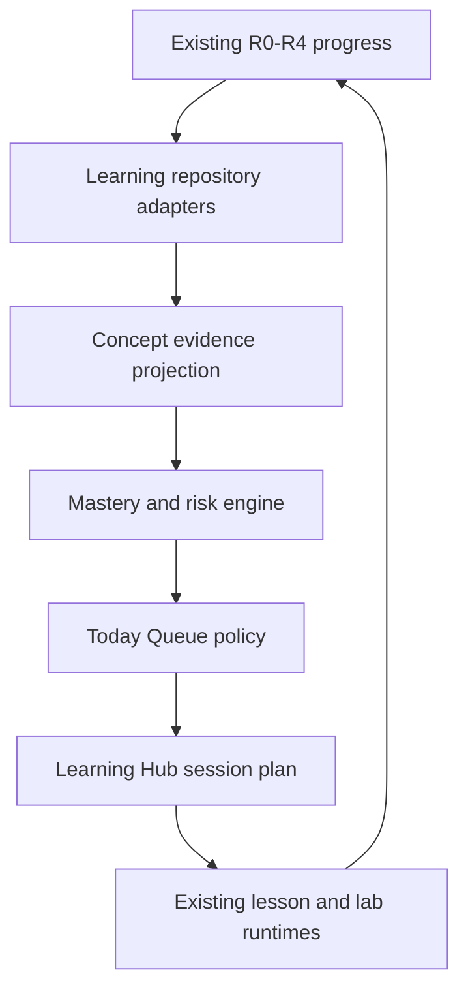

# Adaptive Mastery Foundation Design

**Status:** Proposed for user review

**Date:** 2026-09-05

**Product direction:** Personal-first Adaptive Mastery OS for one learner

## 1. Purpose

This project turns BriliantAI Lab from a growing set of interactive tracks into a system that chooses the next highest-value learning action from evidence.

The first delivery is deliberately smaller than the full twelve-week roadmap. It covers only the foundation that every later milestone depends on:

1. bring production to source parity;
2. preserve and normalize existing R0-R4 progress;
3. compute concept mastery and learning risk deterministically;
4. generate an explainable thirty-minute Today Queue;
5. expose the result on the existing Learning Hub;
6. add release gates for persistence, accessibility, scoring, and queue behavior.

Error Clinic, R5 Data Engineering, the BigTech capstone, IndexedDB migration, and optional cloud sync are separate projects. They consume this foundation but are not implemented here.

## 2. Product outcome

After this project, opening the Learning Hub answers three questions immediately:

- What should I study now?
- Why did the system choose it?
- What evidence will change my mastery state?

The default session budget is thirty minutes. The queue favors due retrieval and unresolved misconceptions over catalog expansion. It never grants mastery from time spent, lesson opening, streaks, or an AI tutor judgment.

### North-star alignment

The project supports the existing north-star metric: **transferable concepts still mastered after seven days**.

The first release does not claim that the learning method is effective merely because the software works. It creates the evidence and deterministic decisions required for a later seven-day pilot.

## 3. Current-state findings

- Production is Site version 24 at commit `d590e5f`.
- The source repository is ahead at commit `c588bbe` and includes the brutalist contrast/accessibility fixes plus the R4 vertical slice.
- R0 progress, R1-R4 expansion progress, diagnostic state, repair queue, and learning log are stored under separate versioned browser-storage keys.
- The current mastery logic is deterministic but lesson-oriented. It does not produce a shared concept snapshot or a ranked cross-track learning queue.
- `app/learning-dashboard.tsx` combines storage hydration, navigation, progress summaries, dialogs, learning runtime, backup/restore, and dashboard presentation in one file.
- `app/globals.css` contains almost two thousand lines, making theme regressions harder to isolate.
- Existing tests cover content, graders, storage restore, R1-R4 mechanisms, rendered HTML, and deployment reliability. They do not yet verify a deterministic cross-track priority policy.

## 4. Scope and decomposition

### In scope

- Production/source parity checkpoint.
- A storage-neutral learning repository interface.
- Adapters that read existing R0 and R1-R4 state without deleting old keys.
- A unified concept evidence projection.
- Deterministic mastery and learning-risk flags.
- A pure Today Queue ranking engine.
- A compact Learning Hub surface showing the session plan and selection reasons.
- Versioned migration markers and recovery behavior.
- Unit, migration, integration, render, accessibility-contract, and anti-regression tests.
- Updated architecture, roadmap, and release notes.

### Out of scope

- New curriculum tracks or R5 lesson content.
- AI-generated lessons, questions, grades, or mastery changes.
- Accounts, public profiles, social features, payments, or leaderboards.
- Server-side arbitrary Python execution.
- A CMS, telemetry backend, or multi-user analytics.
- Full IndexedDB migration. The repository boundary introduced here makes that a later isolated replacement.
- Machine-learned personalization. Priority remains rule-based until pilot evidence justifies a more complex model.

## 5. Architecture

The adaptive layer is a pure decision kernel between existing progress stores and the Learning Hub. UI components do not read browser keys directly, and storage code does not decide what the learner should study.

### 5.1 Modules

#### `lib/learning-repository.ts`

Defines the browser-state boundary.

- Reads diagnostic, lesson progress, expansion progress, repair items, and bounded event metadata.
- Returns normalized domain objects instead of raw JSON.
- Writes only through explicit repository methods.
- Reports malformed or unavailable storage as typed recoverable errors.
- Preserves current versioned keys during this project.

The UI receives a repository instance; tests use an in-memory implementation.

#### `lib/concept-evidence.ts`

Projects lesson and lab progress into one `ConceptSnapshot` per concept.

Each snapshot contains:

- concept and track identifiers;
- prerequisite identifiers;
- practice, variant, transfer, and delayed-review evidence;
- attempt and hint counts;
- unresolved misconception count;
- last practiced and next review timestamps;
- evidence freshness;
- mastery state and risk flags.

No raw explanation, learner code, stdout, or personal text enters the snapshot.

#### `lib/adaptive-mastery.ts`

Computes mastery with explicit rules.

Canonical states remain:

`unexplored -> learning -> practiced -> review_due -> mastered`

The following are orthogonal risk flags rather than extra states:

- `hint_dependent`
- `retry_heavy`
- `misconception_open`
- `stale`
- `prerequisite_blocked`

`mastered` requires all relevant evidence gates:

- independent standard practice;
- a different representation or variant;
- transfer evidence;
- a correct delayed retrieval after at least 72 hours;
- no unresolved critical misconception.

An AI tutor cannot write or override these fields.

#### `lib/today-queue.ts`

Builds queue candidates and ranks them with a deterministic, inspectable score.

Priority score uses five bounded components:

| Component | Range | Meaning |
|---|---:|---|
| Due review | 0-40 | Due and more overdue reviews rise first |
| Misconception | 0-25 | Repeated or critical unresolved errors |
| Prerequisite value | 0-15 | Work that unlocks downstream concepts |
| Assistance risk | 0-10 | High hint use or repeated attempts |
| Freshness balance | 0-10 | Prevents the queue from ignoring new learning forever |

Tie-break order is stable: higher score, older due time, higher prerequisite reach, then lexical candidate ID. The same input and clock always produce the same queue.

The queue targets four slots:

1. retrieval or overdue review, five minutes;
2. repair or prerequisite bridge, eight minutes;
3. deep practice or one new concept, fourteen minutes;
4. short reflection, three minutes.

Empty categories collapse cleanly. The engine never adds low-value filler merely to reach thirty minutes.

Each item exposes a Vietnamese reason such as:

> Ôn Bayes trước vì bài đã quá hạn 2 ngày và lần trước ông dùng gợi ý cấp 2.

#### `components/learning/today-session.tsx`

Presents the queue without becoming a second learning runtime.

- Shows estimated total time and up to four ordered actions.
- Shows one concise reason and the mastery evidence required for each action.
- Opens the existing lesson, expansion lab, edge challenge, delayed review, or repair flow.
- Supports keyboard navigation and touch targets of at least 44 by 44 CSS pixels.
- Announces selected/completed states semantically, not by color alone.

#### `components/learning/mastery-summary.tsx`

Shows a small cross-track summary on the Hub:

- stable mastery;
- review due;
- misconception debt;
- prerequisite-blocked concepts.

It does not display a decorative score without an actionable interpretation.

## 6. Data flow and persistence

### Hydration

1. Server render uses an explicit `not_hydrated` state.
2. Client effect creates the repository and reads current versioned keys.
3. Adapters normalize malformed, legacy, and current values.
4. Concept snapshots are derived in memory.
5. The queue is computed from snapshots and an injected clock.
6. The Hub renders the stable client result.

Browser state must never alter the server-rendered HTML before hydration.

### Compatibility

- Existing `briliantai.lesson.*.progress.v3` keys remain canonical for R0.
- Existing `briliantai.expansion-progress.v3` remains canonical for R1-R4.
- Existing diagnostic, repair queue, and learning log keys remain valid.
- A new `briliantai.adaptive-state.v1` key stores only user preferences and the most recently generated session metadata. It does not duplicate mastery evidence.
- Legacy keys are read but are removed only after a verified successful write of their normalized replacement.
- Learning Passport allowlists the new adaptive key and validates its version and size.

### Failure recovery

- Invalid JSON in one domain is quarantined logically and does not erase the other domains.
- Storage denial or quota failure keeps the current in-memory session usable and shows a persistent backup warning.
- Queue computation failure falls back to existing due-review ordering.
- A broken lab is isolated behind its own error boundary; returning to the Hub retains all previously persisted evidence.
- Restore remains merge-with-rollback and must reproduce the same queue when the backup and clock are identical.

## 7. User experience

The brutalist visual identity remains. This project changes hierarchy and clarity, not the product's personality.

### Hub hierarchy

1. **Today / 30 phút** is the primary surface.
2. **Why these tasks?** expands the evidence behind ranking.
3. **Mastery pulse** summarizes due, stable, blocked, and repair counts.
4. Existing track browsing, History, Passport, Help, and diagnostic remain secondary.

### Visual rules

- Body text is never placed black-on-black or dark-on-dark.
- Black surfaces use white or acid-lime text tokens with WCAG AA contrast.
- Text smaller than 12 CSS pixels is prohibited for learner-facing information.
- Interactive targets are at least 44 by 44 CSS pixels.
- Focus indicators remain visible on black, lime, blue, and paper backgrounds.
- State is communicated through label/icon/ARIA semantics in addition to color.
- Reduced-motion preference disables nonessential transition motion.

## 8. Testing strategy

### Unit tests

- Every mastery state transition and risk flag.
- Queue component scores, stable tie-breaking, injected clock, and empty categories.
- A due review always outranks a new lesson when no critical repair item exists.
- A critical misconception outranks non-due novelty.
- Hints lower evidence strength but cannot erase a completed activity.
- Tutor output cannot mutate mastery.

### Migration and persistence tests

- Current R0-R4 keys produce expected snapshots.
- Legacy keys upgrade without data loss.
- Malformed data in one key does not destroy valid neighboring state.
- Backup and restore include adaptive preferences and reproduce the queue.
- Reload with populated storage produces no hydration mismatch.
- Simulated quota failure preserves the in-memory session and warns the learner.

### Integration and render tests

- Today item opens the correct R0 lesson, R1-R4 lab, edge challenge, repair item, or delayed review.
- Completing an action updates its evidence and recomputes the remaining queue.
- Keyboard users can inspect reasons and launch every action.
- Black surfaces meet the foreground-token contract.
- Mobile layouts have no horizontal overflow and retain 44-pixel targets.

### Existing gates

All current content, Python, SQL, explanation, structure, R3, R4, backup, design, and rendered-HTML tests remain required. The production build continues to run authoring QA before compilation.

## 9. Delivery slices

### Slice 1: Release parity and safety baseline

- Verify source commit `c588bbe` with the complete existing test suite.
- Add targeted contrast regression checks for the reported dark-on-dark failure.
- Save and publish one production version containing the already-completed R4 and accessibility changes.
- Confirm production version provenance and terminal deployment state.

### Slice 2: Repository and evidence projection

- Introduce the repository interface and in-memory test implementation.
- Move dashboard reads behind adapters without changing visible behavior.
- Project R0-R4 state into deterministic concept snapshots.
- Add compatibility, malformed-state, and reload tests.

### Slice 3: Adaptive mastery and Today Queue

- Implement mastery/risk rules and deterministic queue ranking.
- Add queue explanations and stable tie-breaking.
- Render the Today session on the Hub and reuse current learning runtimes.
- Recompute after each completed action.

### Slice 4: Release gate and documentation

- Run lint, production build, authoring audit, and the complete regression suite.
- Perform the explicitly requested browser QA for desktop and mobile Hub paths before publishing this slice.
- Update architecture, roadmap, Learning Passport documentation, and release notes.
- Publish only the exact tested commit.

## 10. Acceptance criteria

The project is complete only when all conditions hold:

1. Production contains R4 and the existing accessibility/contrast corrections.
2. No existing R0-R4 progress is lost or silently reset during upgrade.
3. The Hub produces the same ordered queue for the same evidence and clock.
4. Every queue item states why it was selected and what evidence completes it.
5. Due review and critical misconception work are not displaced by easy novelty.
6. Completion immediately changes the relevant concept snapshot and queue.
7. Reload with populated storage has no hydration mismatch.
8. Learning Passport exports and restores the adaptive preference state safely.
9. No learner-facing dark-on-dark text remains in tested states.
10. All existing and new automated gates pass on the exact published commit.

## 11. Pilot metrics enabled by this foundation

The app records bounded metadata needed to calculate, locally:

- seven-day delayed-review pass rate;
- transfer success without high-level hints;
- review-queue completion;
- recurring misconception rate;
- hint dependency by concept;
- time from first practice to mastery;
- queue acceptance: whether the learner starts the recommended first action.

The first pilot targets are:

- at least 75 percent correct delayed recall after seven days;
- at least 70 percent novel transfer success without high-level hints;
- under 1 percent false acceptance in adversarial grader cases;
- zero blocking progress-loss defects;
- 100 percent keyboard completion of the Hub-to-activity critical path;
- zero known WCAG AA contrast failures on primary surfaces.

These are release-learning targets, not claims guaranteed by implementation.

## 12. Follow-on projects

After this foundation is measured and stable, work proceeds as separate approved specs:

1. **Misconception Error Clinic:** counterexamples, targeted repair, and retest variants.
2. **R5 Data Engineering project lab:** ingest, contracts, transform, warehouse, backfill, lineage, monitoring, and failure recovery.
3. **BigTech capstone:** data-to-AI system with artifacts, evaluation, operational trade-offs, and a design defense.
4. **Product polish:** IndexedDB repository, offline PWA, robust backup, deeper mobile QA, and an exportable Evidence Passport.

Multi-user cloud features remain deferred until the personal mastery pilot meets its learning gates.
